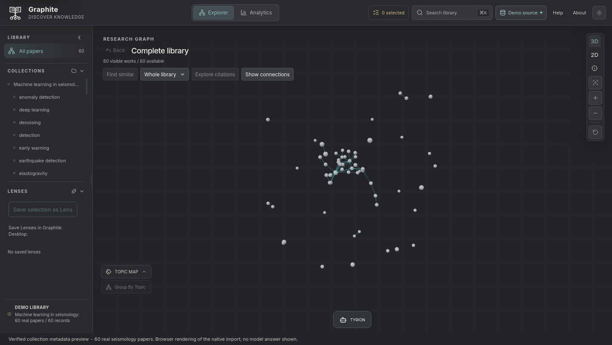

# Graphite

### See the connections. Return to the evidence.

Explore your Zotero library as a research graph, read the original papers,
and ask questions with traceable local evidence.

[Website](https://mbagagli.github.io/graphite/) | [User manual](https://mbagagli.github.io/graphite/manual.html) | [First-use tutorial](https://mbagagli.github.io/graphite/tutorial.html) | [Installation](docs/release/BUILD.md)



_Prepared 60-paper demo with citation links extracted by Graphite's native
pipeline, rendered in an isolated browser. This capture demonstrates the
current interface and verified data, not a packaged desktop runtime or model
answer. Topics remain neutral until semantic indexing._

## From a paper to a research question

- **Explore connections.** Follow citations and semantic neighborhoods;
  keep your selected paper in focus across 2D and 3D views.
- **Read the evidence.** Search available document text, open PDFs, and
  trace answer citations back to their source passages.
- **Work locally.** Graphite keeps its own database and indexes. Zotero
  remains read-only, and original PDFs remain unchanged.

## Start with real research

The built-in demo brings together **60 real papers on seismology and machine
learning**. Browse metadata immediately, then prepare the approximately
412 MB Zenodo PDF archive to explore the documents. Models are separate,
explicit downloads. No Zotero account is needed for the demo.

Follow the [visual first-use tutorial](https://mbagagli.github.io/graphite/tutorial.html)
from preparation to checking your first answer, or read the
[repository walkthrough](docs/release/DEMO.md).

| Find your next step               | Guide                                                          |
| --------------------------------- | -------------------------------------------------------------- |
| Learn the workspace               | [User manual](https://mbagagli.github.io/graphite/manual.html) |
| Prepare the demo or Zotero        | [Library preparation](docs/library-preparation.md)             |
| Navigate papers and relationships | [Graph navigation](docs/graph-navigation.md)                   |
| Annotate a separate PDF copy      | [PDF editing](docs/pdf-editing.md)                             |
| Install a desktop candidate       | [Installation and verification](docs/release/BUILD.md)         |

Graphite is under active development. Platform availability and candidate
verification are documented in the installation guide. Source-grounded
answers still require checking against the papers.

## Saved research Lenses

Keep selected papers or TYRION source papers as a named investigation with
an optional research question. Reopen it after restarting, edit membership,
and explicitly ask within the Lens. Lenses remain separate from Zotero
collections and are scoped to their source library.
See the [Lens guide](docs/lenses.md) for the workflow and current limits.

## Appearance

Graphite includes light and dark themes derived from the bundled Graphite brand
palette. Use the sun/moon button in the application bar to switch themes. The
choice is stored locally; a first launch follows the operating-system color
scheme. Inter is bundled with the application, so the interface does not fetch
fonts at runtime.

## Development

The repository pins Node.js 24.19.0, npm 11.17.0, and Rust 1.97.1. Native
development also requires the platform dependencies for Tauri 2, CMake, a
C/C++ compiler, and libclang development files. GPU builds additionally require
the selected backend toolkit.

Install dependencies from the lockfile and start the isolated desktop
development application:

```bash
npm ci
npm run desktop:dev
```

Desktop development uses `org.graphite.research.dev` and starts with the real
60-paper demo metadata. PDFs are an optional download or offline import.
To test a real library, open Zotero **Settings > Advanced** and enable
**Allow other applications on this computer to communicate with Zotero**
([official setup](https://www.zotero.org/support/dev/web_api/v3/local_api)).
Keep Zotero running, then select **Data Source > Use Zotero** in Graphite. Development data never shares the installed production
identity. Browser-only UI development remains available through `npm run dev`.

See [Development](docs/development.md) for environment isolation, native
requirements, validation, storage behavior, and safe cleanup guidance.
Before pushing changes, install the
[automatic pre-push checks](docs/development.md#automatic-checks-before-pushing)
once in each checkout.
Unsigned native packaging, installed-runtime validation, and current target
limitations are documented in
[Packaging and installed-runtime validation](docs/releasing.md).

Graphite is licensed under GNU GPL v3. Its [privacy policy](PRIVACY.md) describes the small,
explicit set of local integrations and user-requested model downloads. The
[code signing policy](CODE_SIGNING_POLICY.md) records the release trust model
without introducing any runtime account, telemetry, or Graphite-operated
service.

## Local research workflow

The first installed production launch may migrate an existing
application-owned database, model installation, semantic indexes, and
conversations from the previous product identity. Development builds never run
that migration. Close the previous application before this one-time operation.
Existing destination files are never overwritten. Renaming the source checkout
directory is independent of application-data migration.

Graphite reads `http://127.0.0.1:23119/api/` with GET requests, discovers the
personal and local group libraries, synchronizes metadata, and then synchronizes
Zotero-indexed full text. The Data Source control reports metadata and corpus
health separately.

Graphite preserves its existing item and attachment identities behind neutral
source bindings. Non-empty Zotero indexed text is also stored as a versioned,
Graphite-owned canonical document with one exact unstructured block. The
byte-identical flat-text projection remains the input to the current FTS,
citation, chunking, embedding, and RAG pipeline, so attaching canonical
provenance does not rebuild those layers. Canonical backfill runs in bounded,
restartable batches after corpus synchronization.

Extraction quality is tracked separately from execution state. Flat PDF text
without page or layout provenance is usable but reported as degraded. The Data
Source diagnostics show pending, good, degraded, failed, and fallback totals
along with the active provider, routing, and quality profiles.

The reader now offers opt-in **Extract with Docling** on Linux when an existing
isolated Docling runtime is configured. Zotero text remains the default and a
saved alternative. Set `GRAPHITE_DOCLING_RUNTIME` before starting Graphite to
the already provisioned runtime root containing the dedicated
`envs/graphite-rag-comparison` environment and pinned `models` directory. The
adapter requires Docling 2.142.1 and the checked model lock; it does not install
packages, download models, or upload documents. Missing resources fail closed.
No parser or OCR model is bundled with Tauri.

The visibility-aware extraction profile checks native text against a local
rendering before layout and table extraction. It excludes text positioned
entirely on white pixels, including some clipped text layers. Existing
extractions remain available as separate revisions. This conservative check
retains uncertain regions and does not detect every kind of hidden text.

Open a paper, choose **Extract with Docling**, then **Update this paper's
index**. The worker uses CPU execution with automatic OCR and native Markdown
tables. Extraction is bounded to 200 pages, 512 MiB and 15 minutes, with a
16-minute supervisor timeout. The reader exposes cancellation, saved versions,
and interrupted-job recovery. Selecting a saved version invalidates old
passages when text or Docling page provenance changes. Rebuild that paper's
index before asking questions. Zotero synchronization retains an active
Docling choice. Important OCR evidence still needs checking against the PDF;
figure interpretation and automatic repair of column-order errors are not
included. This is an optional integration under fresh validation, not a change
to the default parser or a claim of reliable answers for every PDF.

Graphite continues to own keyword/semantic retrieval, selected-only boundaries,
answer generation and citation checking. RAG-Anything/LightRAG remains a
separate experiment; it is not on the app's answer path.

For quantitative questions with multiple requested quantities, Graphite can
run two complementary searches under the same paper selection. Comparisons
of paper purposes use opening evidence. Explicit ASTM, ISO, and IEC codes
must appear in the cited passages; recognized requested length units are
checked on the visible answer and can trigger the existing single repair.
These checks do not prove general scientific entailment or conversion
arithmetic. Values and supporting passages still need review.

Citation indexing runs against Graphite's prepared document text in bounded
batches. **Prepare library for AI** automatically advances the remaining
batches. Select a paper and use `Index paper` to prioritize its citations.
`Re-resolve references` reruns
only local identity matching. `Rebuild citation index` discards Graphite's
derived extraction/resolution/edge state while preserving compatible manual
review decisions. None of these operations writes to Zotero.

The Paper Inspector exposes references, local cited-by results, and structural
neighbors. Expand a raw reference to inspect provenance or resolve an ambiguous
candidate. Use the neighborhood actions to load a bounded citation,
bibliographic-coupling, or local-corpus co-citation projection. Clicking a
directed citation edge opens its evidence record. External nodes are local
canonical placeholders and are never fetched or added to Zotero automatically.

Global search includes citation-state filters. These are deterministic local
filters and apply to Keyword, Semantic, and Hybrid retrieval.

### Enable local semantic retrieval

1. Open `Data Source` for the demo or your selected Zotero library.
2. Choose `Install embedding model`. This explicitly downloads the supported
   quantized BGE-small-en-v1.5 ONNX model (approximately 35 MB of model data).
3. Choose **Prepare library for AI**. Graphite prepares available document
   text and automatically runs the remaining citation and semantic batches.
   Progress appears beneath the button; cancellation keeps completed work.
4. Open global search and choose `Keyword`, `Semantic`, or `Hybrid`.
5. Select a semantically indexed paper and choose `Similar`, or select several
   papers and choose `Find similar` in the contextual bar.

Hybrid is the default only when semantic coverage exists. Keyword uses FTS5 and
always remains available. Semantic results expose stored passages and scores;
Hybrid fuses lexical and semantic ranks and preserves exact bibliographic
matches. `Rebuild semantic index` deletes and regenerates only Graphite's chunks,
embeddings, vector sidecars, and semantic-neighbor cache. It does not change
Zotero, PDFs, document text, citation evidence, manual overrides, or reader
state.

Model installation may require internet access. Embedding generation,
indexing, Keyword/Semantic/Hybrid search, Similar Papers, and semantic
neighborhoods run locally and do not upload research content. After the model
and index exist, these workflows work from Graphite's cache while Zotero and the
network are unavailable.

### Enable the local research assistant

The assistant is presented as `TYRION` by default. That display identity is
configured in the frontend and remains separate from retrieval, model, and
agent-runtime contracts.

Before the first scientific answer, complete **Enable local semantic
retrieval** above. **Prepare library for AI** synchronizes the selected
library, prepares available text and indexes it to completion. Model
installation stays separate. Without the search model, preparation finishes
what it can and asks you to install that model before resuming. A populated
graph or an installed answer model does not mean document passages are ready.
TYRION shows missing models or partial document coverage beside the composer,
with a button that opens the relevant setup controls.

In Data Source, use **Prepare library for AI** or **Resume preparation**
until the papers you need have passages. The paper inspector's **Semantic representation** shows its passage
count. Its **Index paper** action under References prepares citation data, not
the semantic passages used for scientific answers. If the Reader offers
**Update this paper's index** for saved extraction text, that action prepares
that document's semantic passages directly. Docling is not required: Graphite reuses Zotero text or extracts selectable
text locally from readable PDFs when needed. Scans needing OCR and missing
attachments are reported; other papers continue. See the
[library preparation guide](docs/library-preparation.md).

1. Open the persistent `TYRION` control and choose `Setup`.
2. Inspect the detected CPU, memory, and acceleration status.
3. Explicitly install one curated GGUF profile:
   - `Lightweight`: Qwen3 4B Q4_K_M, about 2.5 GB, 8,192-token context.
   - `Balanced`: Qwen3 8B Q4_K_M, about 5.0 GB, 16,384-token context.
4. Keep `Built-in model` selected, choose Concise or Detailed, and ask a
   question about a paper with indexed passages. For a first check, select
   that paper and use `Selected papers only`. Inspect its returned citations.
   Only one model is loaded at a time; `Unload model` releases it.

The download is pinned to an exact model repository revision, filename, byte
count, and SHA-256 digest. Generation runs in the desktop process, opens no
server port, and has no cloud fallback. Model installation is the only managed
generation step that needs the network. Research text is never uploaded.

Setup offers Auto, CPU, or GPU for built-in answer generation. Auto uses an
eligible CUDA or Metal device, with CPU fallback. Explicit GPU reports a
failure if a device cannot run the model. See
[managed inference hardware](docs/development.md#managed-inference-hardware)
for backend overrides and partial GPU offload.

The standard Linux DEB/AppImage includes CUDA support and a CPU companion.
The Apple Silicon DMG enables Metal. These packages need no development
toolkit.

The square context slider offers Low, Medium (default), High, and Extra-High.
It shows the actual token limit for the selected model: Medium is 4,096 for
Lightweight and 8,192 for Balanced. The limit covers prompt, evidence, and
answer; retrieval can use less. Larger limits can fit more evidence, at a
possible memory and speed cost, without guaranteeing better answers.

Graphite searches your papers and selects relevant passages; an answer model
uses those passages to write a response. **Built-in model** lets Graphite
download and run that model for you, with no other AI app needed.

To reuse a model already running in Ollama or LM Studio on this computer,
expand **Advanced: answer model**, choose **Another app on this computer**,
enable that app's local server, and provide an explicit
`http://127.0.0.1:PORT`, `http://[::1]:PORT`, or `http://localhost:PORT`
OpenAI-compatible endpoint and model name, then run the connection check.
Choose CPU/GPU and the context window in that other app; the Graphite fields
must match its configuration. Redirects and non-loopback addresses are rejected. An optional API key remains
in memory for the request and is not persisted. This key is for the local
server only. OpenAI-compatible describes the connection format, not a
connection to OpenAI; direct LAN, VPS, GPT and Claude cloud connections are
not supported. Graphite still handles retrieval and citations in both modes.

The research assistant resolves current-paper, selected-paper, active-Lens,
collection, or library scope before retrieval. Collection and library scopes
use M4 Hybrid retrieval. Current-paper, selected-paper, and active-Lens scopes
use the same lexical and semantic hybrid retriever with a neutral item
allow-list; an invalid non-empty scope returns no result rather than widening to
the library. The agent bounds evidence and per-paper coverage, skips oversized
blocks while considering later evidence, and displays every supplied source.
Managed models count rendered context with their GGUF tokenizer. External
OpenAI-compatible providers report conservative token estimates explicitly.
Inline `[S1]` citations open the exact local provenance record and, when
available, the Reader page. Answers, source revisions, tool calls, profile
identity, prompt versions, timings, and limitations are saved in Graphite's
database. Saved conversations can be reopened, deleted, or exported as
Markdown.

Select a paper with a PDF in the graph, open its inspector, then choose `Open
paper`. The Rust backend resolves the attachment through Zotero and PDF.js
renders it without exposing its filesystem path to the webview. Page, zoom,
find, panel, and multi-PDF controls are available in the reader.

**Edit PDF** opens a separate local copy with highlights, notes, drawing,
text-run replacement, and page rotation, reordering, insertion, and deletion.
Save the copy in Graphite or export a PDF. Source PDFs and the original text
used by search and citations remain unchanged. See the
[PDF editing guide](docs/pdf-editing.md) for workflow and format limitations.

`Rebuild text index` deletes only Graphite's copied document text and lexical
index; run **Prepare library for AI** to regenerate available text. `Rebuild cache` regenerates the complete
Graphite-owned Zotero partition. Neither action changes Zotero.

PDF availability and text availability are independent. A paper can have
cached Zotero-indexed text without an accessible PDF, or a readable PDF whose
text has not been indexed. Previously synchronized metadata and text remain
searchable while Zotero is closed. A previously resolved PDF can also reopen
offline while its file remains at the validated location.

For browser-only UI development, run `npm run dev`. Browser mode explores
the real 60-paper metadata collection, with keyword search and shared-topic
connections. It has no Zotero, SQLite, PDF download, or model access.

In the desktop app, choose **Use demo data** in Data Source, then
**Prepare library for AI**. Review the size and choose **Download and
prepare** to download the verified ZIP from
[Zenodo](https://doi.org/10.5281/zenodo.24282715). **Already downloaded?** in
that flow accepts the ZIP directly; manual unpacking is unnecessary.
Graphite verifies the 60 PDFs, prepares text and citations, and runs semantic
indexing after the embedding model is installed separately. A progress bar
shows the current stage. The demo stays separate from your Zotero library.

See the [library preparation guide](docs/library-preparation.md) for both
demo and Zotero setup, and the [demo walkthrough](docs/release/DEMO.md) for
collection details. Maintainers can build the three-file Zenodo upload bundle
with `npm run demo:archive -- --zenodo`; see the
[publication instructions](docs/release/ZENODO.md). The current dataset is
published; later dataset revisions require a new verified record. Dataset
verification is separate from application and installer validation.

## Validate

```bash
npm run format:check
npm run lint
npm run check
npm test
npm run build
cargo fmt --manifest-path src-tauri/Cargo.toml --check
cargo clippy --manifest-path src-tauri/Cargo.toml --locked --all-targets -- -D warnings
cargo test --manifest-path src-tauri/Cargo.toml --locked
cargo build --manifest-path src-tauri/Cargo.toml --locked
```

The HTTP integration tests use ephemeral loopback mock servers. Build
`agent-cuda` or `agent-metal` on a host with the corresponding toolkit.
See the [development guide](docs/development.md) for
runtime setup and browser/native checks, and [release validation](docs/releasing.md)
for package, publication-content and privacy checks.

## License

Graphite is open-source software distributed under the [GNU GPL version 3](LICENSE).
